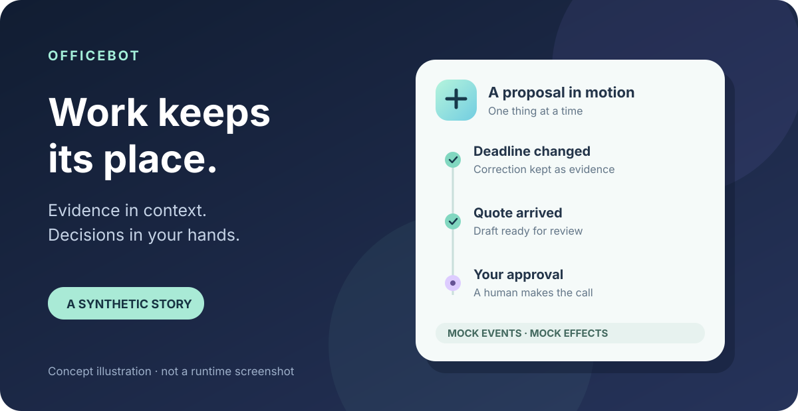

# Officebot — Your 24/7 AI Coworker

[](LICENSE) [](https://github.com/HwangJohn/officebot/actions/workflows/ci.yml) · [한국어](README.ko.md)

**Your office never sleeps. You should.**

Officebot is a local, single-user prototype that follows synthetic office events, keeps the evidence behind its work, and turns a goal into a plan. It can wait for missing information, resume unfinished work, and ask you to approve a proposed shared change. A local dashboard shows what happened; Discord is an optional interface.

- **Remembers context:** keeps local evidence, corrections, and work history together.
- **Moves work forward:** turns a goal into steps and resumes saved work when the app is running.
- **Keeps you in control:** asks for approval before shared mock actions.



The illustration is conceptual. “24/7” describes the intended workflow, not an uptime promise: the process must be running, and supervision is not configured.

## Run locally

Use Node.js 24 (tested with 24.8.0), Git, and npm. Git and npm are also needed for the bounded improvement checks:

```sh
git clone https://github.com/HwangJohn/officebot.git
cd officebot
npm ci --ignore-scripts
npm run build
npm start
```

Open [localhost:4317](http://localhost:4317). Offline mode needs no API key. `.env.example` documents settings and is not loaded automatically. Discord startup catch-up is opt-in only with `WORK_ASSISTANT_DISCORD_CATCHUP=1`. See the [quickstart](docs/2026-10-28--officebot--quickstart.md) for configuration and checks.

## See it in 60 seconds

In a synthetic proposal, the deadline moves from Friday to Thursday. Officebot records the correction and waits for a quote. When the mock quote arrives, it updates the draft and requests approval for a mock message and mock Jira change. You can inspect the evidence and decide what happens next.

1. Start Officebot as described above and open **데모 시나리오** (Demo scenario), then **샘플 업무 열기** (Open sample). The sample includes the deadline correction and a draft waiting for a quote.
2. In the scenario drawer, select **6. 견적 도착** (Quote arrives), then **목표 한 단계 진행** (Advance goal one step).
3. Open **승인함** (Approvals) to review the proposed mock actions. Approve, edit, or reject them; any recorded shared effect stays in the local mock.

The interface currently uses Korean labels. The scenario is synthetic and does not send a business email or update a real Jira issue.

## How it works


Outlook, Teams, Jira, and Confluence are **synthetic mocks**, not connected business systems. Evidence, plans, schedules, approvals, and conversations are stored locally. The scheduler can pick up saved work when the app is running again, subject to its retry and review rules. Approval is required for the shared mock actions; approving one does not grant a real-world integration.

OpenAI and Discord are optional real connections, separately configured. Live OpenAI requests send relevant input and context to OpenAI; use only data you consent to share. This is a local prototype, not an authentication-secured internet-facing SaaS. See [privacy](docs/2026-10-28--officebot--privacy.md) before using live modes or sharing a fork.

## Scope of the public snapshot

The public snapshot excludes existing screenshots, logs, databases, actual identifiers, `.env` files, and private history. `.env.example` is an empty-placeholder reference; the SVG illustrations are newly created. See [privacy](docs/2026-10-28--officebot--privacy.md) for runtime data and sharing guidance.

## Explore and contribute

- [Documentation](docs/README.md) · [Architecture](docs/2026-10-28--officebot--architecture.md) · [Quickstart](docs/2026-10-28--officebot--quickstart.md) · [Verification](docs/2026-10-28--officebot--verification.md) · [한국어](README.ko.md)
- [Contributing](CONTRIBUTING.md) · [Security](SECURITY.md)

An approximately four-week integration planning horizon is a possible roadmap, not a shipped feature: real connectors would need scoped access, consent, data handling, authentication, and effect safety designed and tested first.

Officebot traces its origins to the OpenAI quickstart; its visual design tokens were inspired by OpenMuse. See the repository license notices for attribution.
