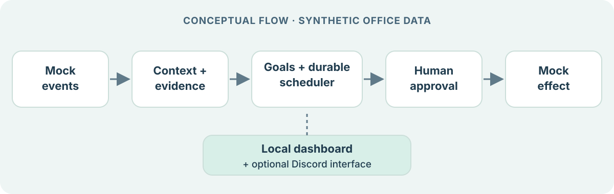

# 2026-10-28 | Officebot architecture | Synthetic work, human decisions

Synthetic Outlook, Teams, Jira, and Confluence events become local context and evidence. Goals use that evidence to build plans and drafts, wait for mock records, and record progress. The durable scheduler stores jobs and checkpoints in SQLite; when the process is running, it can continue eligible work and record reviews. Shared actions go through an approval decision and produce local mock effects only.

The local dashboard presents goals, activity, evidence, drafts, and approvals. Discord is a separately configured optional interface; OpenAI is an optional planning/analysis connection. Neither turns the four synthetic systems into real integrations.

The 24/7 idea is scheduled, resumable work, not a guarantee of continuous availability. This release does not configure a process supervisor or unattended credentials. It is a local single-user prototype, not an internet-facing authenticated service.

## Possible next step

An approximately four-week integration planning effort could define real connector requirements. It would need explicit data sources and scopes, user consent, least-privilege credentials, retention/deletion rules, authentication, auditability, approval and failure recovery for real effects, and tests with synthetic data. It is a planning estimate, not a shipped connector or delivery promise.
